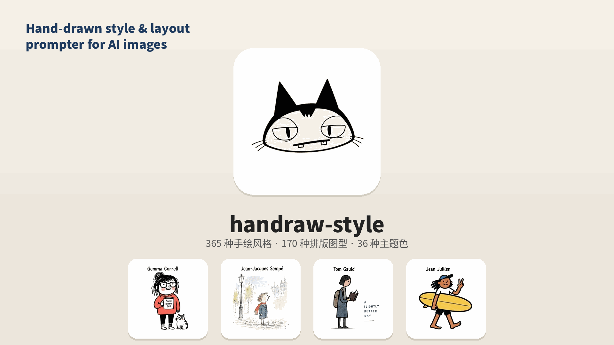

# Do It — 一句话搞定

> **用一句话完成一个任务，让小白也能感受到 AI 的魅力。**

不用记命令行、不用翻冗长的安装教程、也不用自己折腾环境报错。本项目收集真实可用的 **「一句话 AI 任务」** 案例——你只需要复制一句话发给支持操作电脑的 AI 助手（如 Antigravity、Claude Code、Cursor、OpenCode 等），剩下的交给它自动完成。

## 案例目录

| # | 案例 | 一句话指令 |
| :-: | :--- | :--- |
| 01 | [安装开源工具 Magpie](#01-安装开源工具-magpie) | `帮我安装https://github.com/yetone/magpie ，安装目录g:\tools` |
| 02 | [搭建 GPT 号池](#02-搭建-gpt-号池) | `https://github.com/yang0/magpie-gptfree 帮我把号池建起来。我的magpie目录： G:\tools` |
| 03 | [安装 AI 自动化浏览器 ego lite](#03-安装-ai-自动化浏览器-ego-lite) | `https://github.com/citrolabs/ego-lite.git  帮我下载针对本系统的安装包，并安装到g:\tools 目录下。完成安装后：1 删除安装包，2 刷新skill列表确保ego-browser skill有效` |
| 04 | [更新手绘风格提示词库 Skill](#04-更新手绘风格提示词库-skill) | `请更新skill https://github.com/yang0/handraw-style` |
| 05 | [安装开源播放器 Folia](#05-安装开源播放器-folia) | `帮我部署 https://github.com/chthollyphile/folia-major ，安装到 D:\install APP` |

---

## 01. 安装开源工具 Magpie

**发给 AI 的一句话：**

```text
帮我安装https://github.com/yetone/magpie ，安装目录g:\tools
```

**截图：**


**简短说明：**

[Magpie](https://github.com/yetone/magpie) 是一款跨平台的本地 AI 模型网关与多 Agent 管理工具，能把 Claude Code、Codex、Gemini CLI 等数十款 AI 工具的模型配置集中到一处，点一下菜单栏即可切换模型、共享订阅账号并在额度用完时自动无感切换，还内置本地密钥隐私脱敏。以前小白在 GitHub 看到好用的开源软件，往往不知道该下哪个安装包、怎么解压和配置环境变量；现在只需把仓库地址和目标目录一句话发给 AI，它就会自动识别你的电脑系统、下载对应版本并安装配置到 `g:\tools`，全程不用自己动手。

---

## 02. 搭建 GPT 号池

**发给 AI 的一句话：**

```text
https://github.com/yang0/magpie-gptfree 帮我把号池建起来。我的magpie目录： G:\tools
```

**截图：**


**简短说明：**

[magpie-gptfree](https://github.com/yang0/magpie-gptfree) 是一款专为 Magpie 打造的多账号号池插件，支持把批量 GPT 普号直接粘贴或拖入 TXT 一键授权入池，自动同步到供应商列表实现多账号轮询与故障自动切换，还能实时查看每个账号的剩余生图额度，畅享聊天及 `gpt-image-2` / `gpt-image-2.6` 全系列文生图与改图能力，凭证全程加密保存在本机。小白不用自己研究插件怎么装、运行环境怎么配，只需把插件仓库地址和本地 Magpie 目录一句话发给 AI，它就会自动读懂项目文档并把号池插件安装配置到位，打开面板导入账号就能直接用。

---

## 03. 安装 AI 自动化浏览器 ego lite

**发给 AI 的一句话：**

```text
https://github.com/citrolabs/ego-lite.git  帮我下载针对本系统的安装包，并安装到g:\tools 目录下。完成安装后：1 删除安装包，2 刷新skill列表确保ego-browser skill有效
```

**截图：**


**简短说明：**

[ego lite](https://github.com/citrolabs/ego-lite) 是一款专为「人与 AI Agent 并行工作」设计的免费浏览器。它为每个 Agent（如 Claude Code、Codex、Cursor 等）提供独立隔离的 Space 工作区，可一键继承本地浏览器的登录状态与 Cookie，让多个 Agent 在后台高速执行网页自动化任务的同时，完全不抢占你前台正常浏览的标签页和鼠标控制权，安装后还会自动把 `ego-browser` 技能同步给本机各个 Agent。平时在 GitHub 装桌面软件往往要先分清 macOS（Apple Silicon / Intel）还是 Windows 安装包，再手动下载和指定目录安装；现在只要把仓库地址和目标路径一句话发给 AI，它就会自动识别当前系统、下载对应安装包并安装到 `g:\tools` 目录下，装完还会顺手清理安装包并刷新确认 `ego-browser` 技能已生效，全程省心到底。

---

## 04. 更新手绘风格提示词库 Skill

**发给 AI 的一句话：**

```text
请更新skill https://github.com/yang0/handraw-style
```

**截图：**



**简短说明：**

[handraw-style](https://github.com/yang0/handraw-style) 是一款手绘风格与排版图型提示词库 Skill，整理了 **365 种手绘与写实视觉风格**、**170 种排版图型**（社媒卡、信息图、漫画分镜、IP 设计、电商）与 **36 种经典单色主题色**。不会描述画风、排不好版面的新手，只要选定风格编号、排版编号和主题色，告诉 AI 想表现的主题，就能拿到经过实测验证的中英双语生图提示词，直接复制到生图工具出图，不用背诵画风术语、也不用自己构思版面。以前想把这个 Skill 更新到最新版，得自己翻仓库、拉代码、对照文档把风格图鉴、排版模板等资源逐个同步到本机 Agent 目录；现在只需把仓库地址一句话发给 AI，它就会自动拉取最新版本并把全部资源更新到位，全程不用手动折腾。

---

## 05. 安装开源播放器 Folia

**发给 AI 的一句话：**

```text
帮我部署 https://github.com/chthollyphile/folia-major ，安装到 D:\install APP
```

**截图：**


**简短说明：**

[Folia](https://github.com/chthollyphile/folia-major)（辞曲新境）是一款开源的沉浸式歌词音乐播放器，支持本地曲库以及网易云、QQ 音乐、酷狗等平台，桌面端还可接入 Spotify、YouTube Music 等。以前在 GitHub 看到好用的开源播放器，往往要自己分辨系统安装包、选定安装目录再一步步点完向导；现在只需把仓库地址和目标目录一句话发给 AI，它就会自动下载稳定版安装包并安装到 `D:\install APP\Folia`，打开后即可登录原平台或导入本地文件开始听歌。

---

## 一起共建：用「一句话」提交你的 PR

AI 最迷人的地方，不在于多复杂的提示词技巧，而在于你随口说出的一句话，真的帮你解决了一个实际问题。无论你是资深玩家还是刚接触 AI 的新手，只要你也有过 **「一句话让 AI 搞定一件事」** 的惊喜时刻，都非常欢迎 Fork 本仓库并提交 PR，帮更多小白迈出第一步！

哪怕你以前从没用过 Git、不知道怎么提 PR 也没关系——**连提交 PR 本身，也只需要复制下面这句话发给你的 AI 助手：**

```text
帮我 fork https://github.com/yang0/do-it 并提交一个 PR，按仓库现有格式新增案例：【这里填你发给 AI 的那句话】，配图和简短说明请帮我搞定。
```

把 `【...】` 换成你的那句话（有现成截图也可以直接发给 AI），剩下的 Fork、整理配图、撰写说明和提交 PR 全程交给它自动完成。
